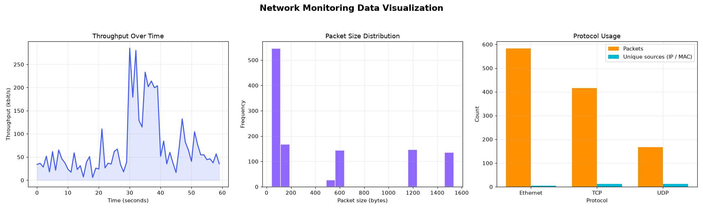
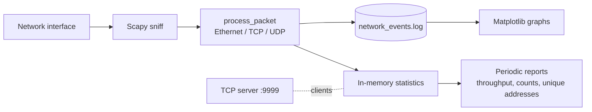

# 📡 Network Monitoring Tool

A **Python** tool that captures live network traffic with **Scapy**, logs every **Ethernet / TCP / UDP**
packet, prints periodic statistics and draws summary graphs with **Matplotlib**.




> The graphs above were generated from the **synthetic** log in
> [`examples/sample_network_events.log`](examples/sample_network_events.log) so you can try the visualisation
> without capturing real traffic.

## Features

- **Live packet capture** of Ethernet, TCP and UDP traffic (Scapy, filter `ip or tcp or udp`)
- **Event log** – one line per packet with timestamp, protocol, source, destination and size
- **Live statistics** every few seconds:
  - throughput per protocol (bits per second)
  - packet count and average packet size per protocol
  - rate of new connections in the last 30 seconds
  - unique IP and MAC addresses seen
  - average flow duration
- **Graphs** – throughput over time, packet-size distribution, protocol usage with unique sources
- **TCP server** (`127.0.0.1:9999`) that accepts clients for real-time data sharing
- **Plot-only mode** – draw graphs from any saved log without capturing anything

## Requirements

- Python 3.9+
- **Windows:** [Npcap](https://npcap.com/) installed, run the terminal **as Administrator**
- **Linux / macOS:** run with `sudo` (raw sockets need elevated rights)

```bash
pip install -r requirements.txt
```

## Usage

```bash
# Live capture (Ctrl+C to stop, graphs open when it ends)
sudo python network_monitor.py

# Choose the log file and report interval
sudo python network_monitor.py --log traffic.log --interval 5

# Draw graphs from an existing log (no admin rights needed)
python network_monitor.py --plot-only traffic.log

# Save the graphs to an image instead of opening a window
python network_monitor.py --plot-only examples/sample_network_events.log --save docs/sample_graphs.png
```

| Option | Default | Description |
| --- | --- | --- |
| `--log` | `network_events.log` | Log file to write |
| `--host` / `--port` | `127.0.0.1` / `9999` | Address of the built-in TCP server |
| `--interval` | `10` | Seconds between throughput reports |
| `--plot-only LOG` | – | Only draw graphs from `LOG` |
| `--save PNG` | – | Save graphs to an image file |

## Log format

```text
2026-01-01 10:00:03 - TCP - Source: 192.168.1.14, Destination: 192.168.1.20 - Size: 1514 bytes
```

## How it works



Capture, the TCP server and the report loop run in separate threads and share state through a lock.

## Project structure

```text
network_monitor.py                 Main tool (NetworkMonitor class, log parser, plotting, CLI)
requirements.txt                   scapy, matplotlib
examples/generate_sample_log.py    Creates a synthetic log
examples/sample_network_events.log Synthetic sample used for the README graphs
docs/sample_graphs.png             Example output
```

## Notes

- Only capture traffic on networks you own or are authorised to monitor.
- "Flow duration" is the time between the first and last packet seen for a source → destination pair.
